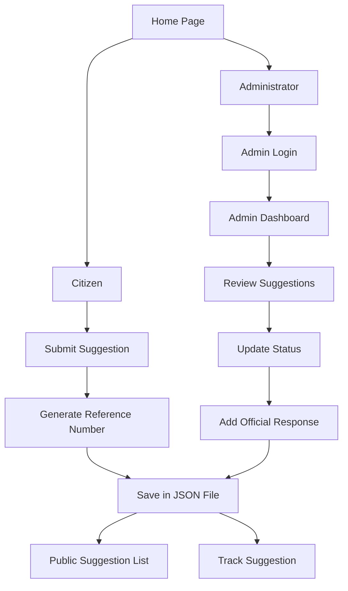

# Group13A
Community Project
```text
About digital suggestion box for local governance

Help me plan simple Web Application with few seed data in json files
backend nodejs
frontend html js CSS

Give planning only so that i can ceate code later
```
# Project Plan: Digital Suggestion Box for Local Governance

A Digital Suggestion Box for Local Governance is a simple web application where citizens can submit suggestions, complaints, and ideas related to their local area. Local government administrators can review submissions, categorize them, update their status, and respond to citizens.

The goal is to build a small, easy-to-understand application using Node.js, HTML, CSS, JavaScript, and JSON files, without requiring a database initially.

## 1. Project objectives

- Provide citizens with a digital platform to share suggestions.
- Encourage public participation in local governance.
- Help local authorities identify community issues.
- Allow administrators to track suggestions and their progress.
- Promote transparency through status updates.
- Maintain a simple record of citizen feedback.

## 2. User roles

Keep only two roles in the initial version.

1. Citizen

- View public suggestions.
- Submit a new suggestion.
- Select a category.
- Track suggestion status.
- View responses from administrators.

2. Administrator

- View all submitted suggestions.
- Review and filter suggestions.
- Change suggestion status.
- Add official responses.
- View basic statistics.
- Manage suggestion categories.

## 3. Main application modules

I recommend starting with six modules.

### Module 1: Home page / Public dashboard

Civic Fix | Devpost

[devpost.com](<https://devpost.com/software/civic-fix?utm_source=chatgpt.com>)

Display:

- Application name and introduction.
- Total suggestions submitted.
- Suggestions under review.
- Suggestions resolved.
- Recent public suggestions.
- Submit Suggestion button.
- Admin Login button.

### Module 2: Citizen suggestion submission

A simple form containing:

| Field | Type |
| --- | --- |
| Citizen Name | Text |
| Email | Email |
| Mobile Number | Text (optional) |
| Ward / Area | Dropdown |
| Category | Dropdown |
| Suggestion Title | Text |
| Description | Textarea |
| Submission Date | Automatic |

Suggested categories:

- Roads and Infrastructure
- Drinking Water
- Sanitation and Waste Management
- Street Lighting
- Public Health
- Education
- Environment
- Public Transport
- Other

After submission, generate a unique reference number, such as `SUG-2026-0001`.

### Module 3: Public suggestion listing

Display suggestions in cards or a table.

Each suggestion should show:

- Reference number
- Title
- Category
- Ward
- Submission date
- Current status
- Official response (if available)

Provide filters:

- Category
- Ward
- Status
- Search by reference number

### Module 4: Suggestion tracking

Citizens can enter their reference number to check the progress.

Suggested statuses:

Submitted

New

Under Review

In progress

Accepted

Approved

In Progress

Action started

Resolved

Completed

Rejected

Not accepted

### Module 5: Administrator dashboard

Smart City 311 App for Civic Services | Silicon IT Hub

[siliconithub.com](<https://www.siliconithub.com/our-products/smart-city-311/?utm_source=chatgpt.com>)

Admin dashboard should contain:

- Total suggestions.
- Pending suggestions.
- Suggestions under review.
- Accepted suggestions.
- Resolved suggestions.
- Rejected suggestions.

Admin management table:

| Reference | Title | Category | Ward | Status |
| --- | --- | --- | --- | --- |
| SUG-001 | Repair road | Infrastructure | Ward 1 | Submitted |
| SUG-002 | Water shortage | Water | Ward 2 | Under Review |
| SUG-003 | Install streetlights | Lighting | Ward 3 | Resolved |

Admin actions:

- View details.
- Change status.
- Add official remarks.
- Update record.

### Module 6: Reports and analytics

Keep this module simple.

Show:

- Suggestions by category.
- Suggestions by ward.
- Monthly submissions.
- Resolved versus pending suggestions.

Use simple charts with JavaScript chart libraries such as Chart.js.

## 4. Suggested project folder structure

Use a simple structure that separates frontend, backend, and seed data.

text

```text
digital-suggestion-box/
│
├── backend/
│   ├── server.js
│   ├── routes/
│   │   ├── suggestionRoutes.js
│   │   ├── adminRoutes.js
│   │   └── categoryRoutes.js
│   │
│   ├── controllers/
│   │   ├── suggestionController.js
│   │   └── adminController.js
│   │
│   ├── services/
│   │   └── jsonService.js
│   │
│   ├── middleware/
│   │   └── authMiddleware.js
│   │
│   └── data/
│       ├── suggestions.json
│       ├── categories.json
│       ├── wards.json
│       └── admins.json
│
├── frontend/
│   ├── index.html
│   ├── submit.html
│   ├── suggestions.html
│   ├── track.html
│   │
│   ├── admin/
│   │   ├── login.html
│   │   ├── dashboard.html
│   │   └── manage-suggestions.html
│   │
│   ├── css/
│   │   ├── style.css
│   │   ├── admin.css
│   │   └── responsive.css
│   │
│   └── js/
│       ├── app.js
│       ├── submit.js
│       ├── suggestions.js
│       ├── track.js
│       └── admin.js
│
├── package.json
└── README.md
```

## 5. JSON seed data planning

Initially, use JSON files instead of MongoDB or MySQL.

Here is the proposed data structure.

A. categories.json

json

```json
[
  {
    "id": 1,
    "name": "Roads and Infrastructure",
    "active": true
  },
  {
    "id": 2,
    "name": "Drinking Water",
    "active": true
  },
  {
    "id": 3,
    "name": "Sanitation",
    "active": true
  },
  {
    "id": 4,
    "name": "Street Lighting",
    "active": true
  }
]
```

B. wards.json

json

```json
[
  {
    "id": 1,
    "name": "Ward 1",
    "area": "City Centre"
  },
  {
    "id": 2,
    "name": "Ward 2",
    "area": "Market Area"
  },
  {
    "id": 3,
    "name": "Ward 3",
    "area": "Residential Area"
  }
]
```

C. suggestions.json

json

```json
[
  {
    "id": "SUG-2026-0001",
    "citizenName": "Ramesh",
    "email": "ramesh@example.com",
    "wardId": 1,
    "categoryId": 1,
    "title": "Repair damaged road",
    "description": "The road near the main market requires repair.",
    "status": "Submitted",
    "adminResponse": "",
    "submittedAt": "2026-11-20",
    "updatedAt": "2026-11-20"
  },
  {
    "id": "SUG-2026-0002",
    "citizenName": "Suma",
    "email": "suma@example.com",
    "wardId": 2,
    "categoryId": 2,
    "title": "Drinking water shortage",
    "description": "Water supply is irregular in our area.",
    "status": "Under Review",
    "adminResponse": "The issue is being examined.",
    "submittedAt": "2026-11-21",
    "updatedAt": "2026-11-22"
  }
]
```

D. admins.json

json

```json
[
  {
    "id": 1,
    "username": "admin",
    "password": "change-this-password",
    "role": "administrator"
  }
]
```

The password above is only a placeholder. In implementation, use password hashing and proper authentication rather than storing plain-text passwords.

## 6. Backend API planning (Node.js + Express)

Plan REST API endpoints as follows:

| Method | API endpoint | Purpose |
| --- | --- | --- |
| GET | `/api/suggestions` | Get all suggestions |
| GET | `/api/suggestions/:id` | Get suggestion details |
| POST | `/api/suggestions` | Submit suggestion |
| GET | `/api/categories` | Get categories |
| GET | `/api/wards` | Get ward list |
| POST | `/api/admin/login` | Admin login |
| GET | `/api/admin/dashboard` | Dashboard statistics |
| PUT | `/api/admin/suggestions/:id` | Update suggestion |
| GET | `/api/admin/suggestions` | Manage all suggestions |

Important: Public APIs should not expose citizens' email addresses or mobile numbers. Admin APIs should require authentication.

## 7. Application workflow

This is the proposed flow of the application.

mermaid



## 8. Technology stack

| Layer | Technology |
| --- | --- |
| Frontend | HTML5 |
| Styling | CSS3 |
| Frontend logic | Vanilla JavaScript |
| Backend | Node.js |
| Backend framework | Express.js |
| Data storage | JSON files |
| Charts | Chart.js |
| API communication | Fetch API |
| Authentication | Express sessions |
| Development | Nodemon |

No React, Angular, Vue, or database is necessary for the first version.

## 9. Development phases

I recommend developing the application in five phases.

1. Phase 1 – Project setup
   - Create folder structure.
   - Set up Node.js and Express.
   - Create frontend pages.
   - Create initial JSON seed files.
2. Phase 2 – Citizen functionality
   - Home page.
   - Suggestion submission form.
   - Save suggestions into JSON.
   - Public suggestion listing.
   - Suggestion tracking.
3. Phase 3 – Administrator functionality
   - Admin login.
   - Dashboard statistics.
   - View and manage suggestions.
   - Update statuses and official responses.
4. Phase 4 – Reports and UI
   - Charts and analytics.
   - Search and filters.
   - Responsive design.
   - Form validation.
5. Phase 5 – Testing and deployment
   - Test all API endpoints.
   - Test citizen and admin workflows.
   - Validate JSON data handling.
   - Deploy the application.

## 10. Recommended scope: Version 1 vs Version 2

Avoid adding too many features initially.

| Feature | Version 1 | Version 2 |
| --- | --- | --- |
| Citizen suggestion submission | Yes |  |
| Admin dashboard | Yes |  |
| JSON file storage | Yes |  |
| Suggestion tracking | Yes |  |
| Ward/category filters | Yes |  |
| Official responses | Yes |  |
| Citizen registration/login |  | Later |
| Anonymous suggestions |  | Later |
| Citizen voting/upvoting |  | Later |
| Email/SMS notifications |  | Later |
| Multiple administrator roles |  | Later |
| Database integration |  | Later |

## 11. Important design and implementation considerations

Since this is intended for local governance, consider these points:

- Privacy: Citizens' contact details should never be visible in the public suggestion list.
- Transparency: Display the status and official response of each suggestion.
- Accountability: Maintain an update history showing when the status changes and who changed it.
- Moderation: Admins should review inappropriate or sensitive submissions before publishing them.
- Data safety: JSON files are suitable for a small demonstration, but concurrent writes can cause data loss. Use safe write operations and backups. Migrate to a database for a real multi-user deployment.
- Security: Validate all inputs on the server, protect admin endpoints, and use secure session settings.

## 12. Final recommended application design

CrowdResolve – Civic Issue Reporting App · Built with Blink

Citizen Grievance Routing System with SLA Tracking | By Nikhil Tiwari

Babu M - Case Study

I would name the project:

Janaspandana – Digital Citizen Suggestion Box

Connecting Citizens with Local Governance.

The first version should have just these six pages:

1. `index.html` – Home and dashboard.
2. `submit.html` – Submit suggestion.
3. `suggestions.html` – View public suggestions.
4. `track.html` – Track suggestion.
5. `admin/login.html` – Administrator login.
6. `admin/dashboard.html` – Manage suggestions and view reports.

This is a manageable project for a student project, academic demonstration, or initial local-governance prototype.

My recommendation: Build Version 1 with a small set of 10–15 seed suggestions, 5 wards, and 8 categories. Keep the code modular so JSON storage can later be replaced with MySQL or MongoDB without redesigning the frontend.
